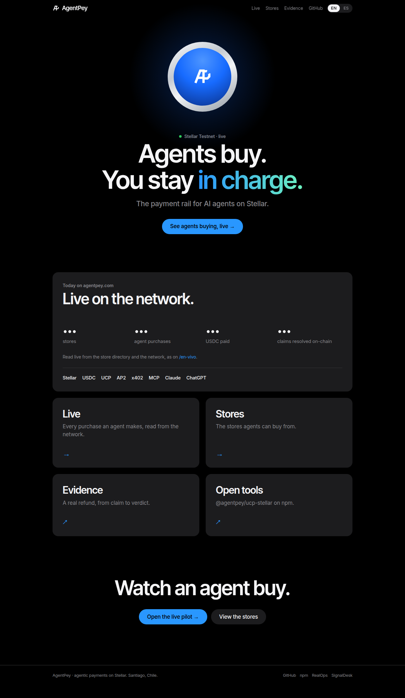
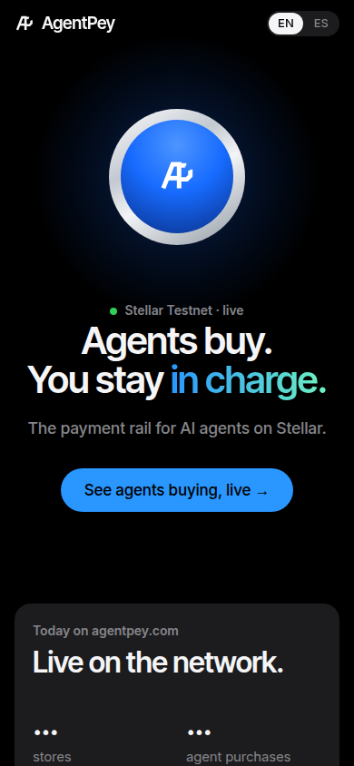
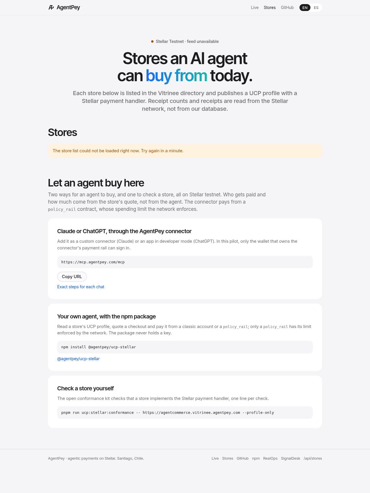
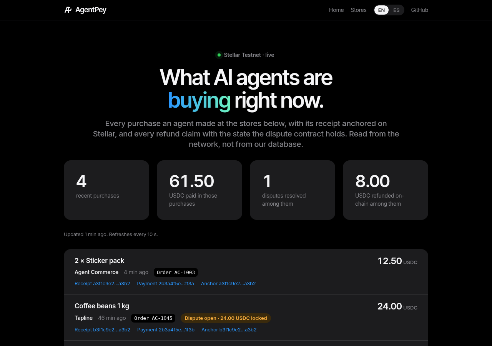
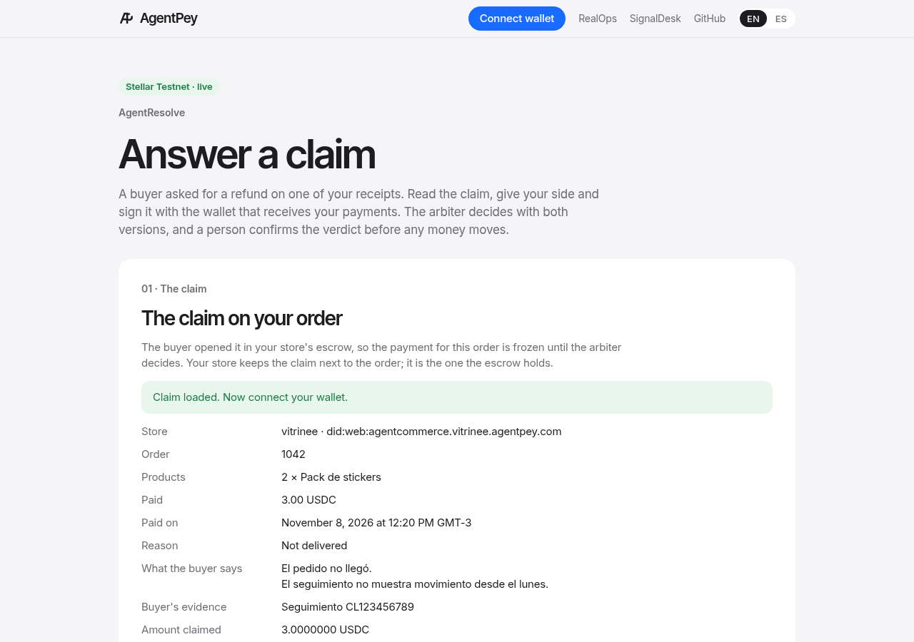
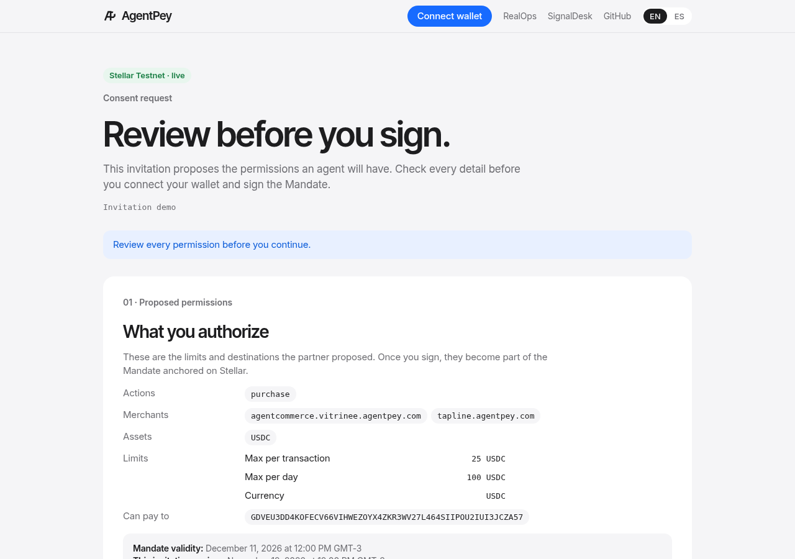
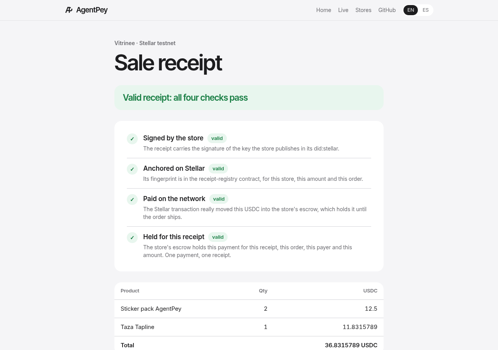
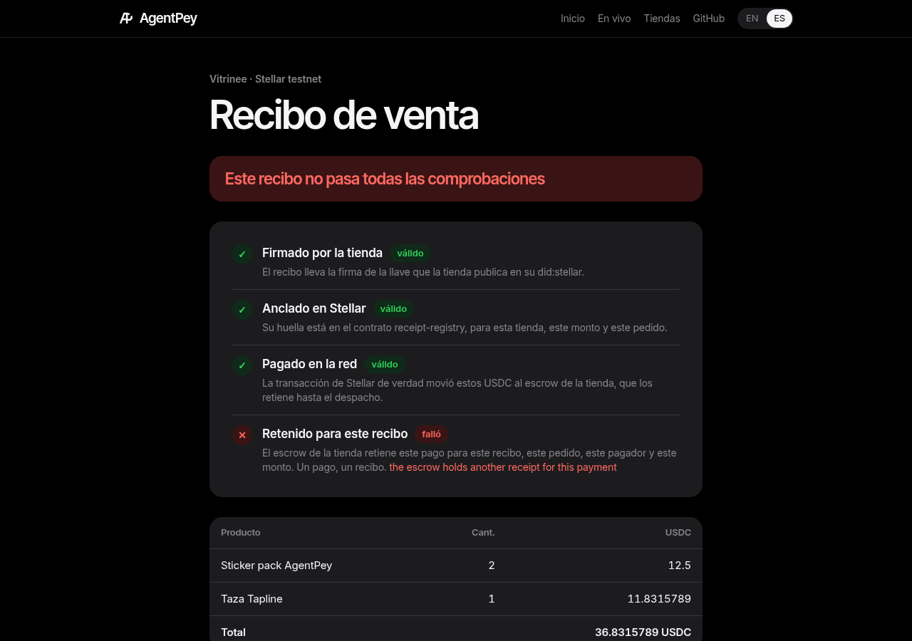
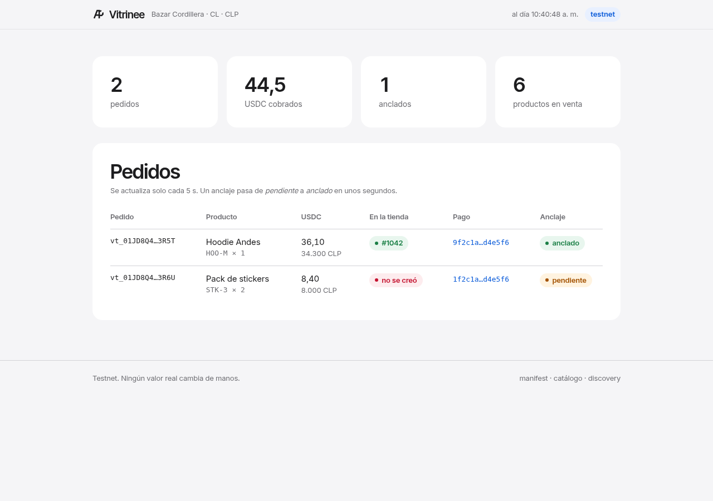
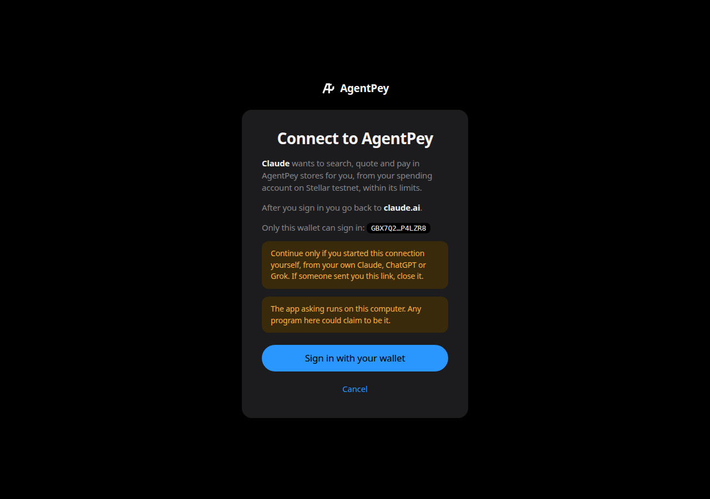

# T207 · Todas las páginas con el diseño de las publicaciones

Fecha: 11-nov-2026. Rama `cc/t207-diseno-unificado`. Diseño fuente: las publicaciones de AgentPey (sesión de AgentSales);
reglas web en [DISENO-WEB.md](../DISENO-WEB.md) y `Y-7`.

## Qué quedó

- **Una hoja única** `apps/web/public/brand/agentpey.css` y el logo `agentpey-mark.svg`. agentpey.com los sirve desde
  `apps/web/public/brand/`; el gateway de Vitrinee, en sus dominios, desde una lista cerrada (`packages/vitrinee-gateway/src/brand.ts`,
  3 pruebas); la consola local de Vitrinee, igual. La página de inicio de sesión del MCP la lleva en línea (su CSP no permite hojas ni
  fuentes externas: se ve con la fuente del sistema).
- **Las 13 páginas** la usan: portada, tiendas, en vivo, responder un reclamo, firmar y revocar un Mandato, laboratorio de wallets,
  recibo, portal, panel y consola de Vitrinee, e inicio de sesión del conector. Ninguna carga Bricolage, Instrument, DM Mono ni el
  naranja `#ff5a36` (`grep` del 11-nov: 0 coincidencias en los 13 archivos).
- **La portada** se rehízo, siempre oscura, estilo keynote: la medalla del post de X en lugar de la escena 3D. La escena (un mercado
  con personas, cajas y destellos naranjas) no quedaba sobria al recolorearla, como pedía la condición del usuario; se quitaron
  `scene.js` y `vendor/three.min.js` (~600 KB menos por visita) y la prueba que los exigía ahora exige que no estén.
- Solo apariencia: los `id`, los textos que leen las pruebas y la lógica de los scripts quedan; en los scripts cambiaron solo nombres de clase.

## Pruebas

- `pnpm check`: salida 0. `pnpm run vitrinee:check`: salida 0 (gateway 522, core 78, adapters 63, anchor 61, agent 11, scripts 70).
- Pruebas cambiadas, porque exigían el aspecto viejo: `apps/web/src/public-pages.test.ts` (la escena 3D, ahora su ausencia; el botón de
  vuelta `class="btn big"`, ahora `ap-btn`) y `packages/vitrinee-gateway/src/checkout.test.ts` (la fuente Instrument Serif, ahora la hoja).

## Capturas (Chrome sin ventana, con datos de muestra locales donde la página lee una API)

| | |
|---|---|
|  |  |
|  |  |
|  |  |
|  |  |
|  |  |
|  | |

**Sin verificar:** los estados que necesitan una wallet real (firmado, revocado, anclado), el selector de wallets del portal y el diálogo
de detalle del panel; las páginas en Safari y en teléfonos reales; y el sitio desplegado (la rama no está mergeada).

## Revisión independiente de UX y UI (11-nov)

Un agente revisor que no participó del rediseño renderizó las 13 páginas en claro y oscuro, a 1280 y 390 px, en inglés y español, con
estados vacíos, de error y completos. Primera pasada: sin bloqueos y seis puntos para corregir (la dirección de la tienda cortada en el
portal en teléfono, el encabezado de tres filas en las páginas de firma, la navegación y el indicador «en vivo» distintos entre páginas, los
comandos de tiendas cortados, emojis en la consola, la captura de la portada sin números) y detalles menores. Se corrigieron todos, más los
detalles: un patrón de encabezado y pie único, el ícono de pestaña visible en oscuro (`agentpey-favicon.svg`, y agentpey.com ahora envía los
`.svg` como `image/svg+xml`), el botón de revocar como destructivo, las filas del panel como tarjetas en el teléfono, el formato de números
en español y el contraste del texto secundario al pasar el puntero en oscuro. Segunda pasada: «listo para mergear» una vez agregado el ícono
al commit; los comandos de tiendas, que seguían cortados en escritorio, ahora van en pasos de una columna y caben en una línea.

Queda sin hacer: un ícono PNG de respaldo para Safari antiguo, y el motivo de falla del recibo en español (viene en inglés del verificador,
como en `main`). `pnpm check` y `vitrinee:check`: salida 0 después de las correcciones.
